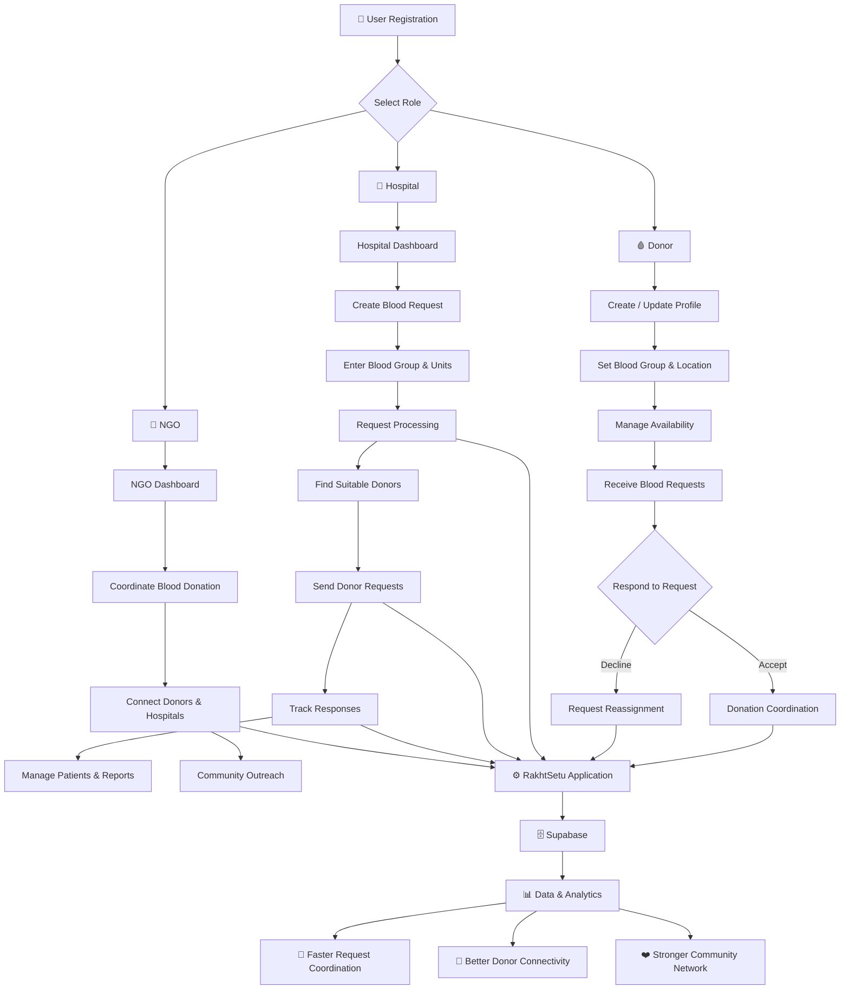
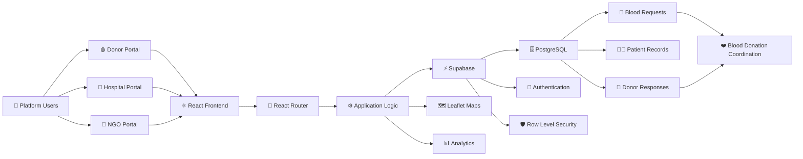
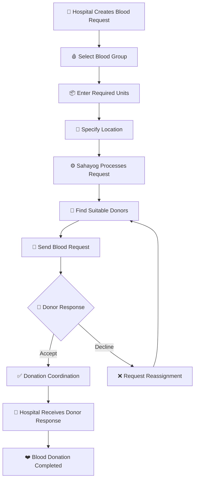
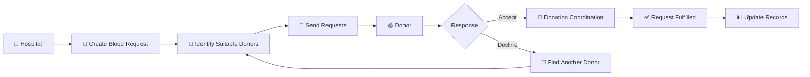

# <p align="center">🩸 SAHAYOG

<p align="center">
  <strong>A Community Blood Donation & Emergency Coordination Platform</strong>
</p>

<p align="center">
  Connecting Donors, Hospitals, NGOs and Communities through a unified digital blood network.
</p>

<p align="center">


</p>

---

## 📌 Overview

**Sahayog** is a community-driven blood donation coordination platform designed to connect **blood donors, hospitals, NGOs and volunteers** through a unified digital ecosystem.

The platform helps hospitals create blood requirements, identify suitable donors, coordinate responses and manage operational information. Donors can manage their availability, receive blood requests and respond to them, while NGOs can support community-level coordination.

### 🎯 Vision

> **Connect. Respond. Donate. Save Lives. ❤️**

RakhtSetu focuses on making blood-donation coordination more organized, responsive and accessible through technology.

---

# 🔄 How Sahayog Works



---

# 🏗️ System Architecture



---

# 🩸 Blood Request Flow



---

# 🩸 Blood Request Flow



---

# 👥 User Roles

| Role | Responsibilities |
|------|------------------|
| 🩸 **Donor** | Manage profile, blood group, location, availability and respond to blood requests |
| 🏥 **Hospital** | Create blood requests, manage patients, coordinate donors and view reports |
| 🤝 **NGO** | Support blood donation coordination, community outreach and donor-hospital connectivity |

---

# ✨ Key Features

| 🩸 Module | 🔹 Feature | 📝 Description |
|---|---|---|
| 🩸 **Donor Dashboard** | Profile Management | Manage donor profile, blood group and location |
| 🩸 **Donor Dashboard** | Availability Management | Update donor availability status |
| 🩸 **Donor Dashboard** | Blood Requests | View and manage incoming blood requests |
| 🩸 **Donor Dashboard** | Response System | Accept or decline blood donation requests |
| 🩸 **Donor Dashboard** | Donation History | Track previous blood donation activities |
| 🩸 **Donor Dashboard** | Nearby Network | Access nearby donor/network information |
| 🩸 **Donor Dashboard** | Notifications | Receive important request and platform notifications |
| 🩸 **Donor Dashboard** | Rewards & Recognition | Recognition through rewards and achievements |
| 🩸 **Donor Dashboard** | Badges | Display donor achievement badges |
| 🩸 **Donor Dashboard** | Impact Tracking | Track personal contribution and donation impact |
| 🏥 **Hospital Dashboard** | Blood Request Management | Create and manage blood requirements |
| 🏥 **Hospital Dashboard** | Patient Management | Manage patient-related information |
| 🏥 **Hospital Dashboard** | Interactive Donor Map | View donors through an interactive map |
| 🏥 **Hospital Dashboard** | Donor Coordination | Coordinate with suitable donors |
| 🏥 **Hospital Dashboard** | Request Tracking | Search, filter, sort and paginate saved requests; review actual donor responses |
| 🏥 **Hospital Dashboard** | Reports & Analytics | Explore date-range request, blood-group, urgency and status charts; export CSV or print |
| 🏥 **Hospital Dashboard** | Hospital Settings | Manage hospital dashboard settings |
| 🏥 **Hospital Dashboard** | Operations Database | Manage hospital operational data |
| 🏥 **Hospital Dashboard** | Map Visualization | Visualize donor locations on the map |
| 🤝 **NGO Dashboard** | NGO Dashboard | Dedicated dashboard for NGO activities |
| 🤝 **NGO Dashboard** | Donation Coordination | Support community blood donation coordination |
| 🤝 **NGO Dashboard** | Donor-Hospital Connectivity | Help connect donors and hospitals |
# 🧩 Core Modules

```text
RakhtSetu
│
├── 🩸 Donor Module
│   ├── Dashboard
│   ├── Availability
│   ├── Requests
│   ├── Responses
│   ├── History
│   ├── Nearby Donors
│   ├── Network
│   ├── Rewards
│   ├── Profile
│   ├── Notifications
│   └── Settings
│
├── 🏥 Hospital Module
│   ├── Dashboard
│   ├── Blood Requests
│   ├── Patients
│   ├── Reports
│   ├── Interactive Map
│   └── Settings
│
├── 🤝 NGO Module
│   └── Dashboard
│
└── ⚙️ Backend Services
    ├── Authentication
    ├── Database
    ├── Request Management
    ├── Donor Responses
    └── Analytics
```

---

# 🛠️ Technology Stack

| 🧩 Category | ⚙️ Technology | 🎯 Purpose |
|---|---|---|
| 🎨 **Frontend** | React | Building the interactive user interface |
| 🎨 **Frontend** | TypeScript | Type-safe application development |
| ⚡ **Build Tool** | Vite | Fast development and production build |
| 🎨 **Styling** | Tailwind CSS | Responsive and modern UI design |
| 🧭 **Routing** | React Router | Client-side navigation and route management |
| ✨ **Animations** | Framer Motion | Smooth UI animations and transitions |
| 🖼️ **Icons** | Lucide React | Consistent interface icons |
| ☁️ **Backend / BaaS** | Supabase | Backend services and application data |
| 🗄️ **Database** | PostgreSQL | Structured application data storage |
| 🔐 **Authentication** | Supabase Auth | User authentication and access management |
| 🛡️ **Security** | Row Level Security | Database-level access control |
| 🗺️ **Maps** | Leaflet | Interactive map integration |
| 📍 **Location Visualization** | Leaflet MarkerCluster | Efficient visualization of multiple map markers |
| 🔧 **Version Control** | Git | Source code version control |
| 🌐 **Repository** | GitHub | Code hosting and collaboration |
| 📦 **Package Manager** | npm / pnpm | Dependency and package management |
| 💻 **Development Environment** | VS Code | Application development and debugging |
# 🔐 Security

Sahayog uses role-based access and database-level security mechanisms to separate functionality between different platform users.

### Security Features

- Authentication
- Role-based protected routes
- Supabase Row Level Security
- User-specific data access
- Protected dashboard routes

---

# 📊 Database

Sahayog uses **Supabase PostgreSQL** for application data.

```text
Users
  │
  ├── Donors
  │     ├── Profile
  │     ├── Availability
  │     ├── History
  │     └── Responses
  │
  ├── Hospitals
  │     ├── Requests
  │     ├── Patients
  │     └── Reports
  │
  └── NGOs
        └── Community Coordination
```

Hospital-specific database operations are maintained through the project's Supabase migration files.

Blood-request distribution is implemented in
`supabase/request-distribution-migration.sql`. For a new Supabase project, apply
`supabase/schema.sql`, `supabase/hospital-operations-migration.sql`,
`supabase/hospital-request-integrity-migration.sql`,
`supabase/profile-rls-registration-migration.sql`, then
`supabase/request-distribution-migration.sql`, and finally
`supabase/donation-recovery-migration.sql`,
`supabase/donor-profile-migration.sql`,
`supabase/donor-request-geographic-matching-migration.sql`, and
`supabase/hospital-network-migration.sql`, followed by
`supabase/donor-response-contact-migration.sql`, and finally
`supabase/ngo-coordination-workflow-migration.sql` and
`supabase/fulfillment-business-rule-migration.sql`, followed by
`supabase/donor-request-location-matching-fix.sql`, and finally
`supabase/fulfillment-single-donor-rule-migration.sql`, followed by
`supabase/hospital-coordination-report-migration.sql`, followed by
`supabase/donor-request-eligibility-reconciliation-migration.sql`, followed by
`supabase/ngo-response-save-reliability-migration.sql`. For an existing project, apply the
migrations in that same order, skipping the base schema only if it is already
installed. After upgrading the prototype workflow, rerun the updated
`request-distribution-migration.sql`, `donation-recovery-migration.sql`, and
`donor-profile-migration.sql`, `donor-request-geographic-matching-migration.sql`,
`hospital-network-migration.sql`, `donor-response-contact-migration.sql`, and
`ngo-coordination-workflow-migration.sql`, and
`fulfillment-business-rule-migration.sql` once each, in that order, followed by
`donor-request-location-matching-fix.sql` and
`fulfillment-single-donor-rule-migration.sql`, and
`hospital-coordination-report-migration.sql`, and
`donor-request-eligibility-reconciliation-migration.sql`, and
`ngo-response-save-reliability-migration.sql`, in the
Supabase SQL Editor using an account with
database-owner privileges. These scripts
replace functions and policies; they do not mark existing organizations or
donors as verified. The geographic-matching migration reconciles existing
request notifications; the location-matching fix reconciles them again after
applying the request-area matching rule and reports eligible-versus-notified
donor counts for active requests. Those counts should be equal for each
request. Donor requests match blood group and either coordinates within the
request/donor radius or the same normalized request/donor area or city. Do not
expose a service-role key in the app.
The eligibility-reconciliation migration is the latest catch-up migration for
existing projects. Apply it after the location-matching fix and other listed
migrations. It refreshes the donor inbox RPC and eligibility triggers, compares
request area/city with donor area/city, retains blood-group, availability,
consent, radius, and recovery safeguards, and inserts notifications for
currently eligible existing requests. Its final diagnostic query reports
eligible and notified donor counts by active request; check that they match.
Saving a donor's matching profile fields also refreshes the donor request feed.
The NGO response save reliability migration repairs missing assignments for
active requests and hardens the authenticated response RPC. It must be applied
after the NGO coordination and request-distribution migrations.
The hospital operations migration creates
`donor_responses` (with `responded_at`/`updated_at`) and hospital notification
preferences. The integrity migration adds request columns used by the form,
backfills missing hospital/NGO records only when the matching profile and
explicit organisation name in the original Auth registration metadata exist,
and installs linked-record RLS policies. At sign-in, the app can also repair
only a legacy hospital row whose `id` already equals the authenticated user
ID and whose `user_id` is null; the corresponding RLS policy permits no other
link change. For this prototype, hospital, NGO, donor, and request verification
are not access or distribution requirements. Hospital and NGO registrations do
not require certificate uploads; new blood requests enter active matching and
are assigned to every NGO profile immediately, regardless of location or
service coverage. Donor matching requires the same blood group, donor
availability ("Ready"), notification consent, and no active recovery or
deferral restriction. When coordinates are available, the donor must fall
within the hospital request radius and donor radius; otherwise, matching falls
back to normalized city names. This prototype bypass must not be treated as
identity review, clinical verification, or production approval.
The request-distribution migration
synchronizes the current `units` field with legacy
`blood_requests.units_required` columns when present, and updates the status
check to accept the current request lifecycle while preserving statuses already
stored in an existing project. It does not invent organisation names or mark
organisations verified. Review its final diagnostic query for records
that still need onboarding data. The profile RLS migration allows authenticated
users to read, create, and update only their own profile. New user profiles and
role records are created by the Auth trigger; the client only inserts missing
records when repairing an authenticated account. The request distribution
migration depends on these tables and installs NGO assignments, donor matching,
notifications, access policies, and triggers. Every open whole-blood request is matched to donors with the same blood group
who are available, opted in, and not under a recovery or deferral restriction.
When both sides have coordinates, the donor must be within both the hospital's
request radius and the donor's radius; if either side lacks coordinates, the
normalized city names must match. Donor profiles can update their saved
location, and the geographic matching migration backfills notifications for
eligible existing requests. Eligible donors also receive notifications when
new requests are created. The request
table is `blood_requests`, not `requests`. The schema and integrity migration
convert a legacy boolean `hospitals.blood_bank` column to the text registration
choices used by the current app before inserting organisation
records. The donation-recovery migration adds request component and radius
fields, hospital acknowledgement of completed donations, donor recovery
history, deferral gates, and issue reporting. Its seeded whole-blood intervals
are **pending** examples, not approved medical guidance; a qualified medical
team must review and explicitly approve applicable, versioned rules before
they can calculate a potential eligibility date. Donors with no recorded
donation history are not put into Recovery Mode solely because no recovery
rule is approved. Donors with existing donation history remain paused for
qualified review until an applicable rule is approved; unsupported or
ambiguous rules do not produce an eligibility date. Request matching remains
preliminary and never constitutes clinical clearance. Approval is a privileged
database operation: after medical review,
set `approval_status = 'approved'`, the reviewer’s Auth user UUID in
`approved_by`, and `approved_at = now()` together. The database rejects an
approved rule without both audit fields. Do not approve the seeded intervals
until the medical team verifies them against applicable policy. Cross-component
rules use JSON objects shaped like
`[{"component":"WHOLE_BLOOD","interval_days":30}]`; the database validates that
shape and the matching gate enforces approved cross-component and annual-limit
rules. Legacy donation dates without a hospital-confirmed record stay blocked
for review rather than being assigned a guessed recovery period. The defaults
are intended to be reviewed against the
[Indian National Standards for Blood Centres](https://clinicalestablishments.mohfw.gov.in/sites/default/files/2023-03/1491_0.pdf),
[Indian donor-selection guidance](https://eraktkosh.mohfw.gov.in/BLDAHIMS/bloodbank/about.cnt?hmode=DOWNLOADDOCUMENTNHRM&type=20),
and [WHO donor-selection guidance](https://www.who.int/publications/i/item/9789241548519).

The donor-response-contact migration requires donors to save a valid phone
number before responding. Once a donor chooses to respond, the requesting
hospital can view their name, phone number, blood group, city, and locality
through a hospital-owned response lookup; donor email, emergency contact,
medical information, and exact coordinates are not exposed. Hospitals can
acknowledge receipt of a response, then acknowledge an actual completed
donation. Only the donation acknowledgement writes donation history and updates
the donor's donation count/date; a response or response acknowledgement alone
does not. The response lookup is restricted to the hospital that owns the
request, and direct response-table writes cannot bypass the response RPC or
hospital acknowledgement flow.

The NGO coordination migration adds one persisted NGO response per request,
consent-gated coordinator contact sharing, NGO contribution history, hospital
coordination status and audit records, and hospital-scoped notification and
report RPCs. A potential-donor offer is not a donor response or completed
donation. NGO responses cannot fulfil a request; fulfilment requires an actual
hospital-recorded donation and at least one distinct donor response. Donation
acknowledgements are stored as approved, copyable messages because email/SMS
delivery is not configured; copied messages are not reported as sent. Apply
this migration after the donor-response-contact migration before using the NGO
Incoming Requests, My Contributions, hospital NGO-response, or acknowledgement
features. The migration and client workflow have not been executed against the
hosted Supabase project; apply and verify it in a database-owner-controlled
Supabase environment before relying on those features.

The hospital coordination report migration updates the all-time summary to
include persisted NGO and linked donor responses in separate totals and in the
combined coordination stages. Donor donation-verification totals include only
completed responses with a hospital-confirmed donation record.

The fulfilment business-rule migration defines the qualifying donor states as
`Response Sent`, `Hospital Confirmed`, `Coordination in Progress`, and
`Completed`, counting distinct linked donor records only. A request can be
marked Fulfilled only with at least one such response and enough persisted,
hospital-confirmed donation records to cover all requested units. Donation
confirmation remains a hospital-authorised action; response totals and donor
matching never fulfil a request automatically. The migration audits and reopens
legacy Fulfilled requests that lack either requirement without creating donation
records; review those audit rows after migration. Dashboard and report metrics
use the same backend qualification snapshot. Apply this migration after the NGO
coordination migration, using a database owner because it temporarily disables
the existing request-workflow trigger while safely reconciling legacy statuses.
The single-donor-rule migration is an incremental update for projects that
already applied the earlier fulfilment migration. It replaces its backend
qualification and status-guard functions so one valid unique donor response
suffices, while keeping hospital verification of donations for every requested
unit mandatory. Apply it after the fulfilment business-rule migration in the
Supabase SQL Editor; the hosted database has not been verified from this
workspace.

### Synthetic MMR demo dataset

The optional demo dataset targets a dedicated, non-production Supabase project.
It creates 50 synthetic hospitals (20 in Mumbai and 30 across the wider MMR),
70 synthetic NGOs, 200 synthetic donors, and 20 synthetic review deferrals.
All records remain `verified = false`, have no real contact information or
registration claims, and use locality-level approximate coordinates. The
prototype's hospital discovery and request matching do not gate on these
verification flags. The seed creates no blood requests, notifications,
donation histories, or recovery dates. Recovery rules remain pending and
require qualified medical approval before dates can be calculated. Never mark
synthetic records verified in a production project.

The tables reference `auth.users`; do not create fabricated Auth foreign keys
in SQL. The supported provisioning helper creates one confirmed test Auth user
per entity through Supabase Auth Admin API, with `example.invalid` emails and a
test password supplied only through process environment variables. It refuses
to run unless the exact project host is allowlisted and an explicit demo-only
confirmation is supplied. It never reads `.env`, prints credentials, deletes
users, or overwrites an existing account without the expected demo marker.
Run it only against an isolated test project with a service-role key:

```powershell
$env:SUPABASE_URL = "https://YOUR_DEMO_PROJECT_REF.supabase.co"
$env:SUPABASE_SERVICE_ROLE_KEY = "YOUR_DEMO_PROJECT_SERVICE_ROLE_KEY"
$env:DEMO_SEED_ALLOWED_PROJECT_HOST = "YOUR_DEMO_PROJECT_REF.supabase.co"
$env:DEMO_SEED_TEST_PASSWORD = "A-unique-long-demo-password"
$env:DEMO_SEED_CONFIRM = "I_UNDERSTAND_DEMO_ONLY"
npm run seed:demo:users
```

Then run `supabase/seed_demo_data.sql` **once** in that same project's
Supabase SQL Editor as a database owner. It uses the Auth-trigger-created
profiles, deterministic demo identifiers, `UPDATE` statements limited to
those marked accounts, and a transaction; re-running it does not duplicate
entities or deferrals. Do not run this against production. Its verification
queries report demo-only counts separately from whole-table counts; no hosted
seed execution has been performed from this repository.

### Isolated hospital/donor request test fixture

The separate small fixture in `supabase/seed_hospital_donor_test_data.sql`
creates exactly 12 synthetic hospitals and 20 synthetic donors across Mumbai,
Thane, and Navi Mumbai. Its blood-group distribution is O+ 4, O- 3, A+ 3,
A- 2, B+ 3, B- 2, AB+ 2, and AB- 1. It covers exact-group matching,
availability and consent exclusion, city fallback when coordinates are
missing, 5 km radius boundaries, unverified-but-eligible profiles, and a
clearly labeled synthetic deferral. It creates no blood requests,
notifications, donation records, or real contact details, and does not mark
anyone verified.

Use a **dedicated, disposable, non-production Supabase project**. The seed
refuses to run if it finds any non-fixture hospitals or donors, any NGOs, or
any blood requests; this prevents its donor-update triggers from distributing
notifications to existing requests. Do not seed the larger demo dataset into
this project. Apply the migrations in the order above,
then provision its 32 Auth users using a service-role key supplied only in
process environment variables:

```powershell
$env:SUPABASE_URL = "https://YOUR_TEST_PROJECT_REF.supabase.co"
$env:SUPABASE_SERVICE_ROLE_KEY = "YOUR_TEST_PROJECT_SERVICE_ROLE_KEY"
$env:HOSPITAL_DONOR_TEST_ALLOWED_PROJECT_HOST = "YOUR_TEST_PROJECT_REF.supabase.co"
$env:HOSPITAL_DONOR_TEST_PASSWORD = "A-unique-long-test-password"
$env:HOSPITAL_DONOR_TEST_CONFIRM = "I_UNDERSTAND_HOSPITAL_DONOR_TEST_ONLY"
npm run seed:hospital-donor-test-users
```

The provisioning script only creates or reuses accounts bearing the exact
synthetic test marker; it refuses to modify or delete an existing account and
checks the exact project host and explicit confirmation. Next, run
`supabase/seed_hospital_donor_test_data.sql`, followed by
`supabase/tests/hospital_donor_network.integration.sql`, in the same project's
Supabase SQL Editor as a database owner. The integration script checks eligible
donors and notification rows for all groups and radii, verifies requests in
the donor feed for eligible and ineligible donors, exercises response and
cancellation behavior, checks RLS, and compares network-directory/map results
with the actual radius predicate. It rolls back all requests, notifications,
and responses it creates.

Keep the fixture for repeat testing or manually review and remove its marked
Auth users and linked records in that disposable project when finished; no
automatic cleanup or hosted-database operation is performed. Run `npm test` for
the repository's automated static fixture checks. The SQL integration test
requires a reachable test database and does not run as part of `npm test`.

After applying the migrations, verify the installed functions, constraints and
pending rule seed with:

```sql
select component, donor_gender, interval_days, effective_from, version,
       approval_status, approved_by, approved_at
from public.donor_recovery_rules
order by component, donor_gender, effective_from;

select conname, convalidated
from pg_constraint
where conrelid = 'public.blood_requests'::regclass
  and conname in (
    'blood_requests_component_supported',
    'blood_requests_search_radius_valid'
  );

select to_regprocedure('public.acknowledge_blood_donation(uuid,uuid,text,timestamp with time zone,integer)'),
       to_regprocedure('public.get_my_donation_recovery()'),
       to_regprocedure('public.get_my_donor_recovery_status()');
```

---

# 🚀 Getting Started

## 1. Clone the Repository

```bash
git clone https://github.com/Komal2008/RakhtSetu.git
```

## 2. Navigate to the Project

```bash
cd RakhtSetu
```

## 3. Install Dependencies

Using npm:

```bash
npm install
```

Or using pnpm:

```bash
pnpm install
```

## 4. Configure Environment Variables

Create a `.env` file in the project root:

```env
VITE_SUPABASE_URL=your_supabase_url
VITE_SUPABASE_ANON_KEY=your_supabase_anon_key
```

> ⚠️ Never commit your `.env` file or expose private API keys.

## 5. Start Development Server

```bash
npm run dev
```

Or:

```bash
pnpm dev
```

---

# 📁 Project Structure

```text
RakhtSetu/
│
├── public/
│   └── sounds/
│
├── src/
│   │
│   ├── components/
│   │   ├── donor/
│   │   ├── hospital/
│   │   └── layout/
│   │
│   ├── context/
│   │
│   ├── data/
│   │
│   ├── pages/
│   │   ├── donor/
│   │   ├── hospital/
│   │   └── ngo/
│   │
│   ├── App.tsx
│   └── main.tsx
│
├── supabase/
│   ├── schema.sql
│   ├── hospital-operations-migration.sql
│   ├── hospital-request-integrity-migration.sql
│   ├── profile-rls-registration-migration.sql
│   ├── request-distribution-migration.sql
│   ├── donation-recovery-migration.sql
│   ├── donor-profile-migration.sql
│   ├── donor-request-geographic-matching-migration.sql
│   ├── ngo-coordination-workflow-migration.sql
│   ├── fulfillment-business-rule-migration.sql
│   ├── fulfillment-single-donor-rule-migration.sql
│   ├── hospital-coordination-report-migration.sql
│   ├── donor-request-eligibility-reconciliation-migration.sql
│   └── ngo-response-save-reliability-migration.sql
│
├── package.json
├── vite.config.ts
└── README.md
```

---

# 🔀 Git Workflow

The project uses feature branches for major modules.

```text
main
 │
 ├── feature/donor-dashboard-complete
 │
 ├── feature/hospital-dashboard-complete
 │
 └── feature/ngo-dashboard-complete
```

Each dashboard is developed independently and integrated through pull requests.

---

# 📌 Development Progress

| Module | Status |
|--------|--------|
| 🩸 Donor Dashboard | ✅ Completed |
| 🏥 Hospital Dashboard | ✅ Completed |
| 🤝 NGO Dashboard | ✅ Completed |
| 🔐 Authentication | ✅ Implemented |
| 🗄️ Supabase Integration | ✅ Implemented |
| 🗺️ Interactive Maps | ✅ Implemented |
| 📊 Reports | ✅ Implemented |
| 🧑‍⚕️ Patient Management | ✅ Implemented |
| 📨 Blood Request Management | ✅ Implemented |

---

# 🎯 Future Scope

Potential future improvements include:

- Real-time donor availability updates
- Advanced donor matching
- Emergency request prioritization
- Notification automation
- Blood inventory integration
- Hospital and blood-bank verification
- Advanced analytics
- Mobile application
- Community engagement and volunteer management

---

# ❤️ Impact

Sahayog is designed around a simple idea:

> **When someone needs blood, finding the right donor should be faster and more coordinated.**

By connecting hospitals, donors and community organizations on a common platform, RakhtSetu provides a digital foundation for more organized blood-donation coordination.

---


This project is developed for educational, research and project-development purposes.

---

<p align="center">
  <strong>🩸 Sahayog — Connect. Respond. Donate. Save Lives. ❤️</strong>
</p>
